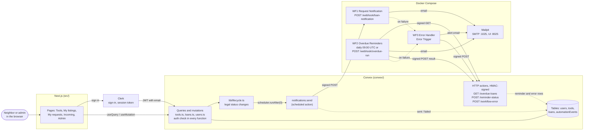
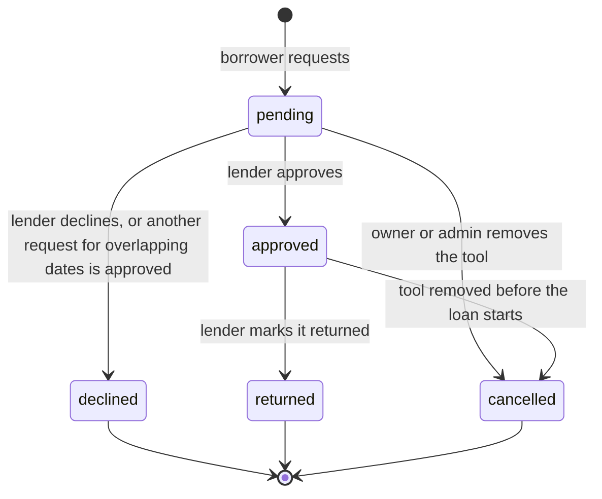
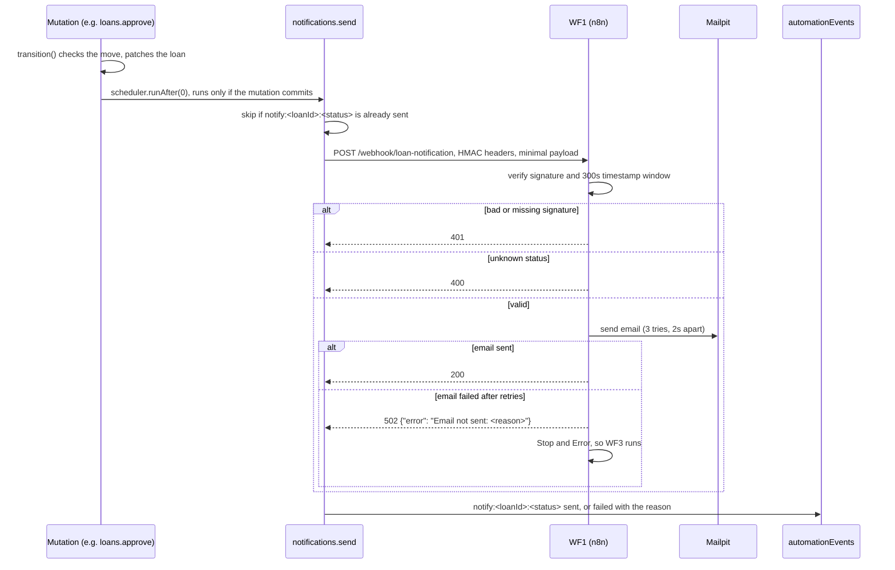
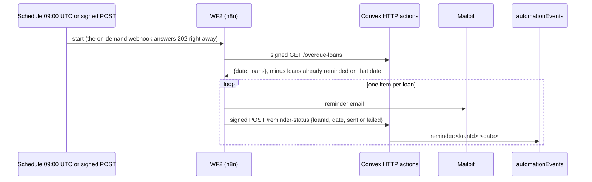
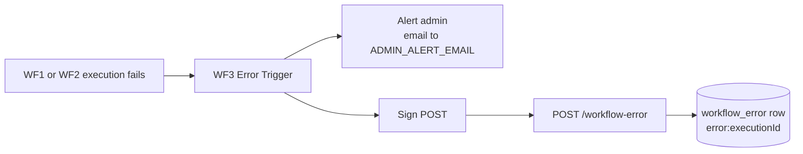

# LendLoop architecture

LendLoop lets neighbors lend and borrow tools. A neighbor lists a tool, another asks to borrow it for a date range, and the owner approves, declines and later marks it returned. Every step emails the person who needs to act, and a borrower who keeps a tool past its end date gets one reminder a day.

This document explains how the pieces connect and why each one is built the way it is. The README has the setup steps.

## The pieces

| Piece | Runs where | Owns |
|---|---|---|
| Next.js 16 (`src/`) | browser, `localhost:3000` | Pages and forms. It hides buttons a user cannot use, but it enforces nothing. |
| Clerk | hosted | Sign-in. It issues a session token with the user's email and whether it is verified. |
| Convex (`convex/`) | `npx convex dev`, functions on `:3210`, HTTP actions on `:3211` | All data and all rules: who may do what, which status changes are legal, what happened in each automation. |
| n8n (`n8n/workflows/`) | Docker, `:5678` | Sending email: WF1 on every loan event, WF2 daily for overdue loans, WF3 when either fails. |
| Mailpit | Docker, SMTP `:1025`, UI `:8025` | A real SMTP server that keeps every email for inspection instead of delivering it. |

## System map

Solid arrows are calls. Dotted arrows are writes into the `automationEvents` audit table.

## Loan lifecycle

Every status change goes through `transition` in `convex/lib/lifecycle.ts`. It checks the move against one table and schedules the notification in the same transaction, so a status change and its email cannot drift apart.

| New status | Who gets the email | Event |
|---|---|---|
| pending | lender | `loan.requested` |
| approved, declined, cancelled, returned | borrower | `loan.status_changed` |

An approved loan whose `endDate` is before today is overdue. "Overdue" is not a stored status. WF2 finds those loans through the `by_status_endDate` index.

## Flow 1: a loan event becomes an email

The action waits up to 30 seconds. With Mailpit stopped, WF1 answered after about 25 seconds, the time its three email tries take. The first version waited 10 seconds and recorded "The signal has been aborted" instead of the real reason.

The payload holds the recipient's email and name, the tool name, the status and the dates. It never holds the other party's email.

## Flow 2: overdue reminders

- **One reminder per loan per day.** Convex builds the key `reminder:<loanId>:<date>` and leaves already-sent loans out of the GET. Running WF2 five times in a day sends one email per loan.
- **The date comes from Convex**, inside the GET response. n8n never uses its own clock for the key, so both sides always agree.
- **One failed email does not stop the others.** The email node sends its error to the next node instead of failing the run. That node reports the loan as `failed`. The next run tries again, and `sent` replaces `failed` on the same key.

## Flow 3: a workflow fails

The two branches start side by side, and both continue when they fail. With Mailpit stopped, the row is still written. With Convex unreachable, the admin still gets the email. WF3 has no error workflow of its own, so it can never trigger itself.

## Security

- **Authorization lives in Convex.** Every query and mutation checks the caller first, with `requireUser`, `requireAdmin` or `getLoanAsLender`, and owner checks run against the row loaded from the database. There are two exceptions. `tools.listPublic` serves the signed-out home page and returns only the name and category of tools that are free. `users.me` returns the caller's own row, or null when signed out. The UI only hides buttons.
- **A lent-out tool stays put.** Its owner cannot remove it until it is marked returned. An admin can remove it, and that cancels the pending and not-yet-started loans, each with its own email.
- **Admin comes from the server.** `users.ensure` grants admin only when the email is in `ADMIN_EMAILS` and Clerk says it is verified. Otherwise anyone could sign up with an admin's address on a provider that does not verify emails.
- **Convex and n8n trust only signatures.** Both directions sign `timestamp\nMETHOD\npath\nbody` with HMAC-SHA256 and a shared secret, `N8N_HMAC_SECRET`. The receiver recomputes the signature, compares it in constant time and rejects timestamps more than 300 seconds off. A changed body, path or method breaks the signature, and an old request cannot be replayed. `signedRoute` is the only way to register a Convex HTTP route, so no route can skip the check. A missing secret rejects everything.
- **A rejected request learns nothing.** A 401 has no body.
- **Minimal data crosses the boundary.** n8n receives one email address per message and nothing else about the users.
- **No secrets in git.** `.env.n8n` is git-ignored. Workflows read secrets through `$env` and the SMTP credential by id. A static test (`convex/n8nWorkflows.test.ts`) fails if an exported workflow contains a 64-hex string, a literal email address, a non-empty password or token field, or any top-level field outside the allow-list.

## Reliability

| What can fail | What happens |
|---|---|
| SMTP down for one email | n8n tries 3 times, 2 seconds apart. WF1 answers 502 with the reason. Convex records `failed` and WF3 records a `workflow_error`. |
| n8n down | `notifications.send` records `failed` with the network error. The user's action still succeeds, because the email runs after the mutation commits. |
| The same event is delivered twice | The idempotency key makes it a no-op. |
| WF2 runs twice in a day | The second run gets an empty list from `/overdue-loans`. |
| A reminder failed yesterday | The next run sends it again and replaces `failed` with `sent`. |

Idempotency keys in `automationEvents`:

| Key | Written by | Meaning |
|---|---|---|
| `notify:<loanId>:<status>` | `notifications.send` | The email for this status change |
| `reminder:<loanId>:<date>` | `POST /reminder-status` | The reminder for this loan on this day |
| `error:<executionId>` | `POST /workflow-error` | One failed n8n execution |

## Decisions and trade-offs

1. **Convex is the source of truth, and n8n only sends email.** n8n holds no state. It can be wiped and reimported from `n8n/workflows/` without losing anything.
2. **Convex pushes events, and n8n pulls overdue loans.** Events happen at a known moment inside a mutation, so pushing them is simple. "Overdue" is a fact about time passing, with no event to push, so WF2 asks for it on a schedule.
3. **HMAC instead of an API key.** A key in a header proves only that the caller knows it. A signature also proves the body was not changed, and the timestamp stops replays.
4. **Convex does not retry, n8n does.** Retrying in both places multiplies attempts. Convex records the outcome, and a later event or run fixes a `failed` row.
5. **A failed email appears twice in `automationEvents`.** The `failed` notification comes from Convex and the `workflow_error` row comes from WF3. Each layer reports what it saw, and keeping both is simpler than merging them.
6. **No Loop node in WF2.** n8n already runs each node once per item, so splitting the list into items is the loop.
7. **Workflows live in git as JSON.** `npm run n8n:export` keeps only `id`, `name`, `nodes`, `connections` and `settings`. A raw export also carries the owner's name and email.
8. **Mailpit instead of a real provider.** It runs real SMTP without credentials, and its REST API lets the E2E check what was sent.

## Testing

- `npm test` covers access rules, loan transitions, notifications, the signed HTTP routes, the HMAC helper and the static workflow checks. It uses Vitest with `convex-test` and needs no running services.
- `npm run e2e:n8n` runs against the real stack. It checks a signed notification, a tampered one, an overdue reminder sent once per day, and a failure reaching the admin and Convex.

## What would change for production

- A real email provider behind the same SMTP credential, with SPF and DKIM set up.
- A managed n8n with its own database, and the secret in a secret manager. Rotating the secret would need a short window where both the old and the new secret are accepted.
- An alert when `automationEvents` collects `failed` rows, instead of relying on someone reading the admin inbox.
- A cleanup job for old `automationEvents` rows.
